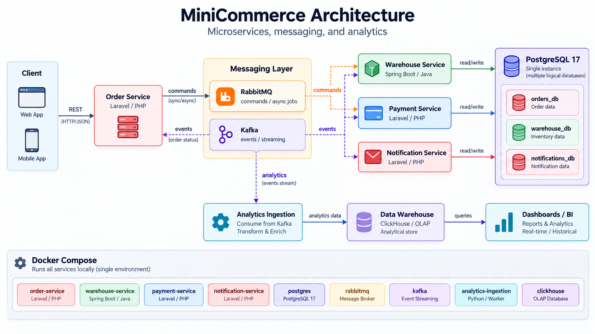

A microservices-based e-commerce backend built with Laravel, Spring Boot, PostgreSQL, RabbitMQ, Kafka, and Docker. Focused on event-driven architecture, reliability, and clean code.

## Architecture

